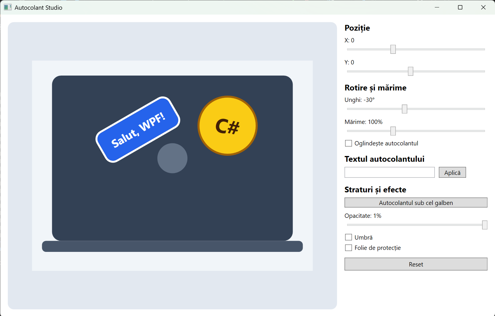
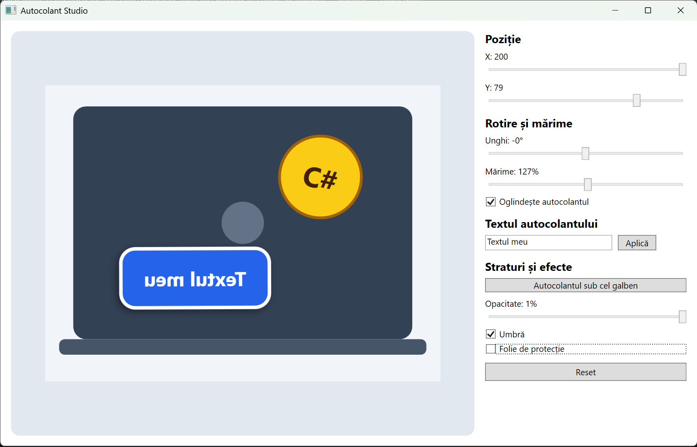
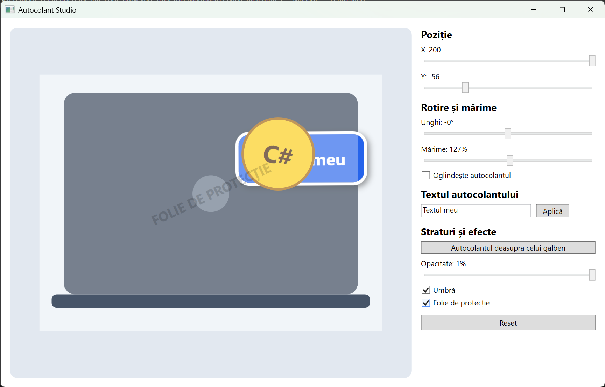

# Raportul laboratorului 7 · Autocolant Studio

| Câmp | Completează |
| --- | --- |
| Nume, prenume | |
| Grupa / subgrupa | P-2341 / |
| Data | 12.10.2026 |
| Sarcini avansate realizate (8, 9) | |

## 1. Explorarea scenei (Sarcina 1)

1. Câte elemente are scena și în ce ordine sunt scrise în XAML?
   > *Răspuns:*
2. Fără `Panel.ZIndex`, care autocolant se vede deasupra și de ce?
   > *Răspuns:*
3. Ce coordonate are colțul stânga-sus al autocolantului albastru în Canvas? Unde este centrul lui?
   > *Răspuns:*

## 2. Tabelul de testare

Scrie **DA** sau **NU** în coloana „Obținut”. Pentru un **NU**, descrie pe scurt ce ai observat.

| Nr. | Acțiune / date | Rezultat așteptat | Obținut |
| --- | --- | --- | --- |
| T1 | Pornirea aplicației | autocolantul albastru nemișcat, textul „Salut, WPF!”, toate valorile inițiale | |
| T2 | Slider X la maxim | autocolantul se mută spre dreapta; textul „X: 200” | |
| T3 | Slider Y la minim | autocolantul urcă; textul „Y: -120” | |
| T4 | Unghi 90 | autocolantul se rotește în sensul acelor de ceasornic, **pe loc**, în jurul centrului | |
| T5 | Unghi 90, apoi X = 100 | autocolantul rotit se mută spre **dreapta** (nu în jos) | |
| T6 | Mărime la maxim | autocolantul de două ori mai mare, nedeformat; „Mărime: 200%” | |
| T7 | Text „Laborator 7” → Aplică | textul apare pe autocolant | |
| T8 | Text gol / doar spații / 20 de caractere → Aplică | mesaj „Date incorecte”, cursorul revine în câmp, textul vechi rămâne | |
| T9 | Butonul de straturi, autocolantul suprapus peste cel galben | autocolantul trece sub cel galben; la al doilea clic revine deasupra | |
| T10 | Opacitate la minim | autocolantul devine semitransparent (30%), laptopul se vede prin el | |
| T11 | Bifare / debifare „Umbră” | apare / dispare umbra | |
| T12 | Reset după toate modificările | toate valorile și textele revin la starea inițială | |
| T13 *(avansat)* | Bifare „Oglindește” la mărimea 150% | textul apare în oglindă, mărimea rămâne 150% | |
| T14 *(avansat)* | Mouse peste autocolant, apoi în afara lui | contur și „aură” aurie; la ieșire revine umbra aleasă | |
| T15 *(avansat)* | Bifare „Folie de protecție”, apoi mouse peste autocolant | apare folia; evidențierea la mouse funcționează și sub folie | |

## 3. Întrebări de control

1. De ce am folosit `TranslateTransform` și nu `Canvas.Left` pentru mutarea din Slider?
   > *Răspuns:*
2. Ce s-ar întâmpla dacă `TranslateTransform` ar fi scris **înaintea** lui `RotateTransform`? Verifică cu testul T5.
   > *Răspuns:*
3. De ce este nevoie de `RenderTransformOrigin="0.5,0.5"`?
   > *Răspuns:*
4. De ce handler-ele `ValueChanged` încep cu `if (!IsLoaded) return;`?
   > *Răspuns:*
5. Prin ce diferă `Opacity="0"` de `Visibility="Collapsed"`?
   > *Răspuns:*

## 4. Capturi de ecran

Pune în `docs/capturi/` și verifică să se vadă aici:

## 5. Reflecție

- Ce a fost cel mai ușor?
  > *Răspuns:*
- Unde ai greșit și cum ai găsit greșeala?
  > *Răspuns:*
