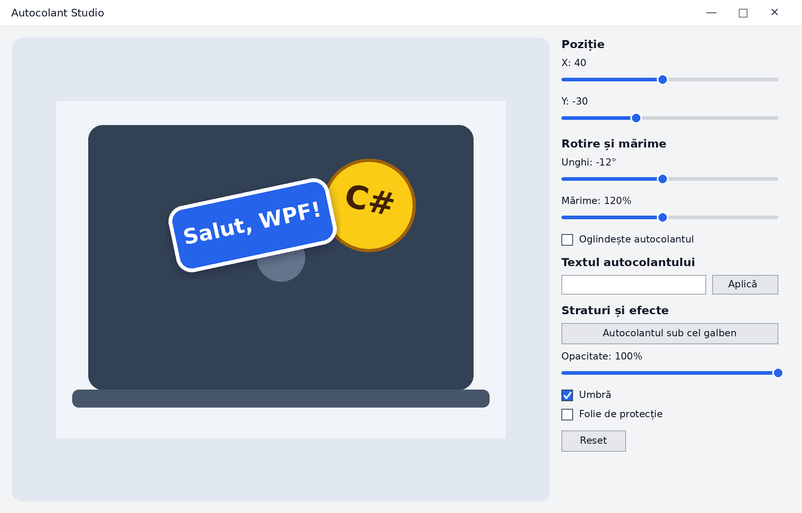

# Laboratorul 7 · Autocolant Studio

**S.05.O.021 Programarea vizuală** · Unitatea 2. Grafică, animație și efecte vizuale
Combinarea și stratificarea elementelor grafice: translație, rotație, scalare, `TransformGroup` și efecte simple
Abilitățile **A31–A35** · 2 ore · C#, .NET 10, WPF

## Ce construiești

Aplicația **Autocolant Studio** arată capacul unui laptop pe care sunt lipite două autocolante:
unul galben, fix, și unul albastru, pe care îl controlezi tu. Din panoul din dreapta poți:

- muta, roti și mări autocolantul albastru (Slider-e);
- schimba textul autocolantului, cu validare;
- pune autocolantul sub sau deasupra celui galben;
- schimba opacitatea și adăuga o umbră;
- reveni la starea inițială cu **Reset**.

Interfața este deja desenată. Tu scrii transformările în XAML și codul C# din metodele marcate cu `TODO`.
Sarcinile detaliate, indicațiile și baremul sunt în **fișa de lucru** primită la oră.

## Pasul 0 · Pregătirea

1. Creează-ți copia: butonul verde **Use this template → Create a new repository**
   (sau acceptă tema din linkul GitHub Classroom primit de la profesor).
   Numele repozitoriului: `lab07-autocolant-NumePrenume`.
2. În Visual Studio: **Git → Clone Repository**, lipește adresa repozitoriului tău.
3. Deschide `AutocolantStudio.sln` și apasă **F5**. Trebuie să vezi laptopul și cele două autocolante.
   Slider-ele încă nu fac nimic — asta e treaba ta.

## Structura repozitoriului

| Fișier / folder | Rol |
| --- | --- |
| `AutocolantStudio/MainWindow.xaml` | interfața: scena (Canvas) și panoul de comenzi — **completezi** |
| `AutocolantStudio/MainWindow.xaml.cs` | logica: metodele cu `TODO` — **completezi** |
| `AutocolantStudio/App.xaml`, `AssemblyInfo.cs` | pornirea aplicației — nu modifici |
| `RAPORT.md` | tabelul de testare, răspunsurile și reflecția — **completezi** |
| `docs/interfata-tinta.png` | cum trebuie să arate aplicația |
| `docs/capturi/` | aici pui cele 3 capturi de ecran cerute |
| `.github/workflows/build.yml` | verifică automat că proiectul se compilează |

## Sarcinile pe scurt

| Nr. | Sarcina | Unde | Nivel |
| --- | --- | --- | --- |
| 1 | Explorează scena și straturile existente | `MainWindow.xaml`, `RAPORT.md` | obligatoriu |
| 2 | Adaugă `TransformGroup` (Scale → Rotate → Translate) autocolantului | XAML | obligatoriu |
| 3 | Deplasarea cu Slider-ele X și Y | C# | obligatoriu |
| 4 | Rotirea și mărimea | C# | obligatoriu |
| 5 | Textul autocolantului, cu validare (1–14 caractere) | C# | obligatoriu |
| 6 | Straturi (`Panel.ZIndex`), opacitate și umbră | XAML + C# | obligatoriu |
| 7 | Butonul Reset | C# | obligatoriu |
| 8 | Oglindirea și evidențierea la mouse | XAML + C# | avansat |
| 9 | Folia de protecție (strat peste scenă) | XAML + C# | avansat |

## Reguli de lucru cu Git

- Rulează aplicația după **fiecare** sarcină și fă un commit doar dacă funcționează.
- Minimum **5 commit-uri**, cu mesaje clare, de exemplu:
  - `Sarcina 2: TransformGroup pentru autocolant`
  - `Sarcina 5: validarea textului`
- Fă **Push** la sfârșitul fiecărei etape — așa nu pierzi munca dacă se oprește calculatorul.
- Nu urca pe GitHub folderele `bin/`, `obj/`, `.vs/` (fișierul `.gitignore` le exclude deja).

## Predarea

Înainte de termen, verifică:

- [ ] aplicația pornește și toate sarcinile obligatorii funcționează;
- [ ] `RAPORT.md` are tabelul de testare completat și răspunsurile la întrebări;
- [ ] în `docs/capturi/` sunt cele 3 capturi: `1-initial.png`, `2-transformat.png`, `3-straturi.png`;
- [ ] ai cel puțin 5 commit-uri și ai făcut Push;
- [ ] în fila **Actions** ultima rulare are bifă verde (proiectul se compilează);
- [ ] ai trimis linkul repozitoriului în Google Classroom.

> **Condiție de evaluare:** un proiect care nu se compilează (bifă roșie în Actions) nu se evaluează.
> O funcție doar desenată, fără comportament, nu se punctează.

## Materiale de sprijin

- Suportul teoretic al lecției 7 — secțiunile 1–8 și exemplul rezolvat **EtichetaPromo** (model de referință).
- Ordinea recomandată în `TransformGroup`: **Scale → Skew → Rotate → Translate**.
- Handler-ele `ValueChanged` încep cu `if (!IsLoaded) return;`.
